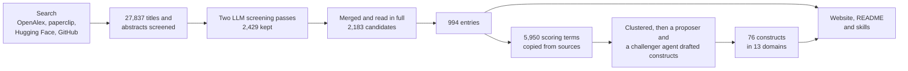

<!-- Generated by scripts/build_readme.py from data/about.yaml and the catalog. Edit those, not this file. -->

<p align="center"></p>
<h1 align="center">awesome health ai evals</h1>
<p align="center">A catalog of benchmarks and evaluation frameworks for health chatbots, sorted by where their questions come from and what they judge.</p>
<p align="center"><a href="https://awesome-health-ai-evals-iota.vercel.app"><b>Browse the catalog</b></a> &nbsp;·&nbsp; <a href="https://awesome-health-ai-evals-iota.vercel.app/#/constructs">Constructs</a> &nbsp;·&nbsp; <a href="https://awesome-health-ai-evals-iota.vercel.app/#/glossary">Glossary</a> &nbsp;·&nbsp; <a href="https://awesome-health-ai-evals-iota.vercel.app/#/about">About</a></p>

## What's inside

- 994 benchmarks and evaluation frameworks (795 benchmarks, 199 frameworks) for judging how a model answers health questions or talks with people about their health.
- Questions from 72 countries in 75 languages. 177 entries have questions written in low- and middle-income countries, and 6 include questions from a low-income country.
- 5,950 scoring terms copied from 818 sources, matched to 76 shared constructs in 13 domains, so you can compare benchmarks that use different words for the same thing.

This is an exploratory catalog, not a systematic review, and language models did most of the reading. Some facts will be wrong. Each entry lists its sources so you can check them.

## How the catalog was built



Every step left files in the repository, so you can check any decision.

1. **Search.** Queries to OpenAlex (keywords, papers citing anchor benchmarks such as MedQA and HealthBench, and the reference lists of surveys), paperclip (arXiv, medRxiv, PubMed Central and an abstracts corpus), Hugging Face and GitHub. 212 logged queries returned 27,750 unique records after removing duplicates by DOI, arXiv ID and title. Queries are in [search/queries.yaml](search/queries.yaml) and hit counts in [search/log.csv](search/log.csv).
2. **Screening.** A small OpenAI model screened 27,837 titles and abstracts against the inclusion criteria and kept anything uncertain. A larger model rescreened what it kept with a stricter prompt, leaving 2,429 records ([search/screening.csv](search/screening.csv)).
3. **Reading.** Records about the same benchmark were merged into 2,183 candidates ([search/candidates.csv](search/candidates.csv)). Claude agents read the full text, dataset card or README of each, then wrote an entry with its facts or logged why not ([search/extraction/](search/extraction/)). Review agents rechecked the weakest entries.
4. **Terms.** For every entry, agents copied each term it scores answers on (an axis, criterion, metric and so on) with its definition in the source's words ([terms/](terms/)). A later pass with the OpenAI API wrote each entry's card from the paper, dataset card or README: what the model has to do, how the items were made, how an output becomes a score, who judges it, and the headline result ([scripts/build_cards.py](scripts/build_cards.py)).
5. **Constructs.** The terms were embedded and clustered. One agent proposed constructs from the clusters, and a second argued against the draft from the view of a primary-care clinician in a low-resource setting. The reconciled result and every decision are in [taxonomy/](taxonomy/), and each term is mapped to constructs with a match type (same idea, narrower, broader, or overlapping).
6. **Labels.** Entries record facts: languages, countries, who built the set, how questions were made and how answers are scored. Labels such as income group and origin are derived from those facts at build time, using the World Bank classification pinned in [data/countries.csv](data/countries.csv).

Scope and decisions are in [docs/plan.md](docs/plan.md).

## Start here

Widely used benchmarks and ones built in low- and middle-income countries. Everything else is on the [website](https://awesome-health-ai-evals-iota.vercel.app/#/catalog).

- [Rwandan CHW vignette benchmark](https://awesome-health-ai-evals-iota.vercel.app/#/e/rwanda-chw-vignettes) (2026). 524 clinical vignette questions written by Rwandan community health workers (from 5,609 collected), with clinician and LLM answers rated on an 11-metric expert rubric.
- [HealthBench](https://awesome-health-ai-evals-iota.vercel.app/#/e/healthbench) (2025). 5,000 multi-turn health conversations between a model and a layperson or health professional, each with physician-written rubric criteria (48,562 in all), scored by a model-based grader validated against physicians.
- [Kenya Nurse Vignettes](https://awesome-health-ai-evals-iota.vercel.app/#/e/kenya-nurse-vignettes) (2025). Primary-care clinical scenarios co-designed and written by 145 Kenyan nurses (7,606 in the source pool; 507 stratified across 12 nursing competency categories used for benchmarking), with clinician answers and physician-panel ratings on an 11-domain rubric.
- [MedHELM](https://awesome-health-ai-evals-iota.vercel.app/#/e/medhelm) (2025). An extensible evaluation framework with a clinician-validated taxonomy of medical tasks (5 categories, 22 subcategories, 121 tasks) and a suite of 35 benchmarks scored by exact match, automatic metrics, and a three-model LLM jury validated against clinicians.
- [AfriMed-QA](https://awesome-health-ai-evals-iota.vercel.app/#/e/afrimed-qa) (2024). About 15,000 English medical questions from 16 countries, mostly in sub-Saharan Africa (multiple choice, short answer, and consumer queries), written by clinicians and medical trainees, scored by accuracy, text-similarity metrics, and clinician and lay ratings.
- [EquityMedQA](https://awesome-health-ai-evals-iota.vercel.app/#/e/equitymedqa) (2024). Seven datasets (4,619 adversarial medical questions in total) enriched for equity-related bias, plus a multifactorial rubric for physician, health-equity-expert, and consumer rating of long-form LLM answers.
- [MMedBench](https://awesome-health-ai-evals-iota.vercel.app/#/e/mmedbench) (2024). 53,566 medical multiple-choice questions in six languages (English, Chinese, Japanese, French, Russian, Spanish), pooled from existing national exam datasets and given GPT-4-written rationales that were human-checked for the test set; scored by accuracy and rationale quality.
- [QUEST](https://awesome-health-ai-evals-iota.vercel.app/#/e/quest) (2024). A human-evaluation framework for health LLMs, derived from a review of 142 studies, with five principles (Quality of information, Understanding and reasoning, Expression style and persona, Safety and harm, Trust and confidence) and guidance on planning, rating, and scoring.
- [CRAFT-MD](https://awesome-health-ai-evals-iota.vercel.app/#/e/craft-md) (2023). A framework that tests clinical LLMs on simulated doctor-patient conversations (patient-AI, grader-AI, expert checks) instead of static vignettes, using case vignettes across 12 specialties from MedQA-USMLE and public and private dermatology sets, with a live leaderboard.
- [MedMCQA](https://awesome-health-ai-evals-iota.vercel.app/#/e/medmcqa) (2022). More than 194,000 four-option multiple-choice questions from Indian postgraduate medical entrance exams (AIIMS PG and NEET PG) and mock exams, covering 21 subjects and 2,400 topics, with explanations; scored by accuracy.
- [MultiMedQA](https://awesome-health-ai-evals-iota.vercel.app/#/e/multimedqa) (2022). A suite of seven English medical QA datasets (MedQA, MedMCQA, PubMedQA, MMLU clinical topics, LiveQA, MedicationQA, and the new HealthSearchQA of 3,173 commonly searched consumer questions), with a human evaluation framework for long-form answers rated by clinicians and lay users.
- [MedQA](https://awesome-health-ai-evals-iota.vercel.app/#/e/medqa) (2020). About 61,000 multiple-choice questions from medical licensing exams in the United States (USMLE, English), mainland China (simplified Chinese), and Taiwan (traditional Chinese), with a textbook corpus for retrieval; scored by accuracy.
- [PubMedQA](https://awesome-health-ai-evals-iota.vercel.app/#/e/pubmedqa) (2019). Biomedical research questions taken from PubMed article titles, answered yes, no, or maybe from the abstract; 1,000 expert-annotated test items plus 61,200 unlabeled and 211,300 automatically generated items; scored by accuracy and macro-F1.

## Use it

- **Website.** Filter the catalog, see where questions come from on a map, check which constructs are tested in which settings, and compare benchmarks side by side. The full data is one JSON file at [/data/catalog.json](https://awesome-health-ai-evals-iota.vercel.app/data/catalog.json).
- **Claude Code skills.** [skills/](skills/) has four skills that work from this catalog: find-health-benchmarks, adapt-benchmark-rubric, score-transcripts-with-rubric and run-open-benchmark. Install them as a plugin:

  ```
  /plugin marketplace add littlehifive/awesome-health-ai-evals
  /plugin install health-ai-evals@health-ai-evals
  ```

- **Build it yourself.** `uv run scripts/validate.py` checks the entries, `uv run scripts/build_site.py` builds the site into `site/dist`, and `uv run scripts/build_readme.py` regenerates the README.

## Repository layout

| Path | What's there |
|---|---|
| [`entries/`](entries/) | One YAML file per benchmark or framework. Fields are described in [schema/README.md](schema/README.md). |
| [`terms/`](terms/) | The scoring terms each entry uses, with definitions and where they appear in the source. |
| [`taxonomy/`](taxonomy/) | Term clusters, the proposed and challenged constructs, the final constructs and mappings, and the decision log. |
| [`search/`](search/) | Queries, hit counts, screening labels, candidates and extraction logs. |
| [`data/`](data/) | Pinned country table, related guidance and surveys, the glossary, and this About text. |
| [`scripts/`](scripts/) | Search, screening, validation and build scripts. |
| [`site/`](site/) | The website (plain HTML, CSS and JavaScript). |
| [`skills/`](skills/) | Claude Code skills that use the catalog. |
| [`docs/`](docs/) | The plan and the instructions given to agents. |

## How not to use it

- **As a ranking.** Citations, downloads and stars show attention, not quality.
- **As a measure of the field.** The counts reflect what was published in English and turned up in these searches. Evaluations that teams build for their own chatbots are mostly missing.
- **As the last word on any entry.** Language models extracted the facts. Check the sources listed on each entry before you cite a detail.
- **As an agreed taxonomy.** The constructs are a draft built with LLM help. Use them to find and compare evaluations, not to claim two scores measure the same thing.
- **To compare scores across benchmarks.** Two benchmarks that judge the same construct still differ in their questions, raters and scales.

## Known gaps

- The search was in English only, so benchmarks described only in other languages are likely missing.
- Implementers rarely publish the evaluation sets they build for their own chatbots, so practice is undercounted. If you have one you can share, even as a description, please [open an issue](https://github.com/littlehifive/awesome-health-ai-evals/issues/new).
- Language models did the screening and extraction. Expect some misclassified records and wrong facts.
- The constructs are a working draft built with LLM help, not an agreed taxonomy.
- Image question answering in radiology and pathology, clinical documentation and coding, biomedical text mining and drug discovery are out of scope on purpose.
- The constructs don't yet record whose guideline or standard of care a reference answer follows. That matters when a benchmark rewards advice that fits a US hospital but not a rural clinic.

## Contributing

Open an issue to add a benchmark or correct an entry, or send a pull request that edits the entry's YAML file. `uv run scripts/validate.py` checks it.

## License

Code: MIT. Content (entries, data, README): CC BY 4.0. Datasets are linked, not re-hosted; each keeps its own license.

_Last built 2026-10-27._
